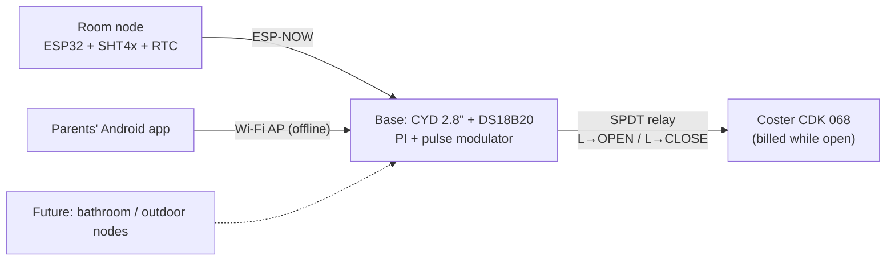

# TermoMade

**Pulse-controlled zone-valve thermostat for a mountain house on time-billed central heating.**
A **CYD touchscreen base station** (on the old thermostat's 503 box) drives the Coster 3-point
valve and fuses its own temperature sensor with a **wireless room node** (which also keeps the
clock). A small **Android app** lets the family control it over the house's own Wi-Fi. Fully
offline: no internet on site. Bathroom/outdoor sensors can be added later.

> Status: **firmware written** (base CYD v0.2 + room node v0.1 + 46 native tests), compiles, not
> yet run on hardware. Base v0.2: ARRIVO button (60 min forced heating, chosen by simulation),
> 8 hidden settings pages incl. manual date/time, LDR light sensing. Next: bench bring-up
> ([firmware/README.md](firmware/README.md)), decisions D13 (neutral in the 503 box?), D18 (relay
> module type), D23 (planned return).

## The idea in one paragraph

The heating is billed by **how long the zone valve is open**, and the water from the condominium
plant is very hot. A classic thermostat keeps the valve open long after the radiators are full,
sending hot water back to the plant (billed, not used). Then it overshoots, because the radiators
are still full of heat when it stops. TermoMade instead **opens the valve just long enough to fill
the circuit (3 min), closes it, and lets the radiators release that heat unbilled**. A PI
controller sets how often to pulse (and, only in very cold weather, how long), always respecting
**ON ≥ 3 min** and **OFF ≥ 5 min**.

Simulation (`tools/sim`, guessed plant parameters) vs a classic ±0.2 °C thermostat:

| | Classic thermostat | TermoMade |
|---|---|---|
| Billed valve time, winter day | 254 min | **177 min (−30 %)** |
| Compensated meter units (UNI/TR 11388-like) | 3.47 | **2.08 (−40 %)** |
| Room temperature RMS error | 0.50 °C | **0.13 °C** |
| Overshoot after cold arrival | 0.73 °C | **0.28 °C** |
| Valve cycles/day | 29 | 59 |

Caution: under time billing a **deep night setback raises billed time** (morning recovery with the
valve wide open is the least efficient regime). The default is a shallow, pulse-only recovered
night. See [04 §5](docs/04-control-algorithm.md#5-recovery-cold-start-morning-boost).



## Documentation

| Doc | Content |
|---|---|
| [01 Requirements](docs/01-requirements.md) | Problem, goals, functional/non-functional requirements, acceptance criteria |
| [02 Heating physics](docs/02-heating-physics.md) | Billing types, why pulsing saves, overshoot cause, simulation results |
| [03 Architecture](docs/03-architecture.md) | Nodes, data flow, room policies, modes, failure modes, network modes |
| [04 Control algorithm](docs/04-control-algorithm.md) | **The spec:** PI, pulse modulator, valve FSM, fallback, parameters, tuning |
| [05 Hardware](docs/05-hardware.md) | CYD pin map, relay stage, bypass switch, sensors, BOM, enclosures, site survey |
| [06 Communication](docs/06-communication.md) | ESP-NOW frames, pairing, channel handling, API gotchas |
| [07 User interface](docs/07-user-interface.md) | CYD screens, LED, buzzer, web UI, JSON API, serial CLI |
| [08 Software](docs/08-software.md) | Toolchain, libraries, repo layout, task model, conventions, gotchas |
| [09 Logging & evaluation](docs/09-logging-evaluation.md) | CSV formats, KPIs, baseline vs TermoMade A/B protocol |
| [10 Roadmap](docs/10-roadmap.md) | **Decisions (answered + open)**, phases, risks |
| [11 Legacy review](docs/11-legacy-review.md) | What the old `Termostato.ino` really did, bugs, what we keep |
| [12 Android app](docs/12-android-app.md) | Parents' app: WebView shell, binding to the offline AP, build & install |
| [13 Enclosure](docs/13-enclosure.md) | **2-part OpenSCAD box on the 503 box (v1 model + STLs)**: layout, joint, print & assembly, mains safety |

## Repository layout

```
docs/               plan & knowledge base (start here)
tools/sim/          Python thermal simulator (design tool) + arrival_study.py
tools/ui_preview/   renders the CYD screens on a PC from the real firmware UI code
reference/legacy/   old single-board sketch, kept for reference
firmware/           PlatformIO monorepo: base (CYD), room node, libraries, tests
android/            parents' app (Phase 3)
hardware/           wiring, enclosures (OpenSCAD), datasheets (Phase 0+)
CLAUDE.md           context for AI-assisted sessions
```

## Quick start (simulator)

```bash
cd tools/sim
python3 thermal_sim.py               # comparison tables
python3 thermal_sim.py --plot out/   # + PNG plots (matplotlib)
```
