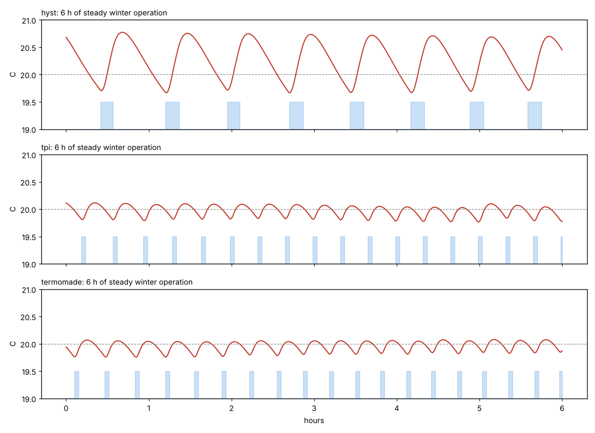
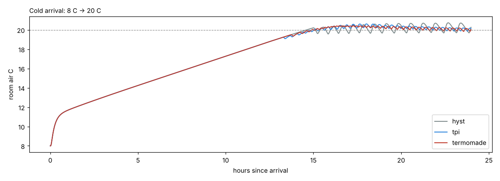

# 02 — Why pulsing works (physics, billing, simulation)

## 1. How the bill is made

In Italian condominiums with centralised heating, each unit's share is apportioned under
UNI 10200. The bill has a **fixed part** (involuntary consumption, by thousandths) and a
**variable part** from the unit's meter. Pulsing can only reduce the **variable** part.

Three metering families exist. Find out which one you have, because the answer changes how much
you save:

| Metering | What is counted | Effect of pulsing |
|---|---|---|
| **Pure time counter** (valve-open hours) | Time the zone valve is open | **Large saving**: billed time ↓ about 30 % in simulation |
| **Compensated insertion time** (UNI/TR 11388 "tempi di inserzione") | Open time × (mean of flow & return − room temp), scaled by emitter power | **Large saving**: about 40 % fewer units in simulation, because each pulse starts by returning cold water |
| **Direct heat meter** (flow × ΔT, "contacalorie") | Real energy | **No billing advantage**. Comfort still improves, and less overshoot means slightly less energy |

The request says "billed by time of flowing", which is the first or second family. Both favour
pulsing. Check the meter's label or the condominium's apportionment report (*ripartizione*) to
confirm which one you have.

## 2. Hot water in the radiators is stored energy you've already paid for

Order-of-magnitude numbers for the apartment circuit (the same guesses the simulator uses):

| Quantity | Value |
|---|---|
| Water in radiators + apartment piping | ≈ 30 L |
| Radiator metal (aluminium) | ≈ 70 kJ/K |
| Circuit heat capacity | 30 × 4.19 + 70 ≈ **196 kJ/K ≈ 0.054 kWh/K** |
| Flow when the valve is open | ≈ 10 L/min → fill time 30 L / 10 L/min = **3 min** (matches your measurement) |
| Supply temperature | ≈ 75 °C ("very hot") |

**During a fill** the water entering is 75 °C and the water pushed out is the cooled water from
the previous pulse (≈ 35 °C):
10 L/min × 4.19 kJ/kgK × 40 K ≈ 1.7 MJ/min ≈ **0.47 kWh per billed minute**.

**Once the circuit is full** of hot water, every extra minute just sends ≈ 65–70 °C water back to
the plant. The apartment only gets what the radiators emit at full temperature, about 8 kW ≈
**0.13 kWh per billed minute**.

So a "fill minute" buys about **3–4 times** more heat than a "keep-open minute". Rules that follow:

1. **ON ≈ fill time** whenever possible. Modulate how often you pulse, not how long.
2. **Lengthen ON only when pulses are already as frequent as OFF_MIN allows.**
3. **Let the radiators cool between pulses.** Longer OFF means colder water to push out, which
   means more heat per billed minute (and more comfort ripple, which the PI keeps small).

Side effect: the condominium plant gets colder return water, which helps condensing boilers. It
is good for the building too.

## 3. Why the old thermostat overshoots

A classic on/off thermostat keeps the valve open for ~10 min (or more) until the air reaches
setpoint + hysteresis. At that moment the radiators hold ≈ 0.054 kWh/K × (70 − 20) K ≈ **2.7 kWh**
of heat that still has to reach the room. The room keeps warming: **overshoot**. On the way down,
the radiators are cold when the valve reopens, so the room falls below the setpoint before the
heat arrives: **undershoot**. Delivering heat in small, frequent quanta removes most of both.

## 4. Simulation

The model is in `tools/sim/thermal_sim.py`. It has an air node, a building-mass node, the radiator
circuit as 8 segments in series (plug flow, so the hot front really does take 3 min to fill the
circuit), a valve with 30 s stroke, and a lagged and noisy remote sensor reporting every 30 s.
It compares:

- **hyst**: classic thermostat, ±0.2 °C hysteresis
- **tpi**: PI + fixed 20 min period time-proportioning (common in commercial thermostats), with
  the same min ON/OFF
- **termomade**: PI + the pulse modulator from [04-control-algorithm](04-control-algorithm.md)

Results (days 2–4 of each run, setpoint 20 °C; raw output in `img/sim_results.txt`):

| Weather | Controller | Billed min/day | kWh per billed min | Compensated units | RMS error | Max T | Valve cycles/day |
|---|---|---|---|---|---|---|---|
| Winter (−2 ± 5 °C) | hyst | 254 | 0.33 | 3.47 | 0.50 °C | 20.99 | 29 |
| | tpi | 177 | 0.47 | 2.07 | 0.13 °C | 20.28 | 59 |
| | **termomade** | **177 (−30 %)** | **0.47** | **2.08 (−40 %)** | **0.13 °C** | 20.25 | 59 |
| Cold (−10 ± 5 °C) | hyst | 452 | 0.25 | 6.66 | 0.33 °C | 20.67 | 38 |
| | tpi | 335 | 0.34 | 4.54 | 0.14 °C | 20.30 | 67 |
| | **termomade** | **310 (−31 %)** | **0.37** | **4.06 (−39 %)** | **0.07 °C** | 20.15 | 103 |
| Mild (+8 ± 5 °C) | hyst | 105 | 0.42 | 1.29 | 0.59 °C | 21.31 | 15 |
| | tpi | 77 | 0.57 | 0.79 | 0.33 °C | 20.72 | 26 |
| | **termomade** | **77 (−27 %)** | **0.57** | **0.79 (−39 %)** | **0.31 °C** | 20.70 | 26 |

Cold arrival (house at 8 °C, setpoint 20 °C): all controllers take ≈ 14 h because the walls have to
warm up. Overshoot after arrival is 0.73 °C (hyst) vs **0.43 °C** (termomade). Pre-heating before
arrival is therefore a valuable feature *if* the house has internet (F18).

### What the simulation says (and doesn't)

- **Pulsing itself is the big win** (−27…−31 % billed time, −39…−40 % compensated units). The
  result held across plant variants: supply 65 °C (−34 %), cast-iron radiators (−28 %), undersized
  radiators (−40 %), heavy building (−30 %).
- **The pulse modulator vs a fixed-period TPI** matters mostly in **cold weather** (−8 % billed
  time and half the RMS error), because TPI lengthens ON while the modulator shortens OFF.
- **Mild weather limit:** one fill pulse is a fixed heat quantum (≈ 1.7 kWh here). When the demand is
  low the room ripples ±0.3–0.4 °C. Options: accept it, or allow a shorter "partial fill" ON_MIN
  in mild weather (parameter, off by default).
- **Valve cycles go up** 2–3×. Check the actuator's rated cycles and keep the cycle counter and the
  max cycles/hour limit.
- **The absolute numbers are guesses.** Calibrate the model with logged data (fill time, cooling
  curve) in Phase 4.
- **Derivative action did not help** in simulation (pulse ripple + sensor lag). Default Td = 0.
  The term exists in firmware but stays off.
