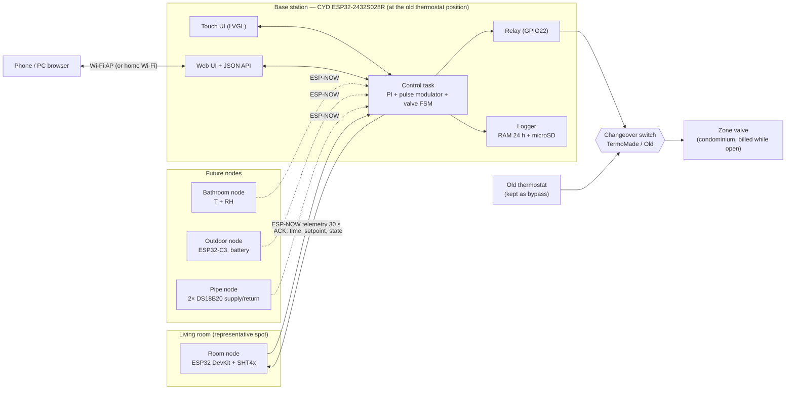

# 03 — System architecture

## Overview

## Node responsibilities

| Node | Does | Does **not** do |
|---|---|---|
| **Base (CYD)** | Holds all state and settings, runs the controller, owns the relay, UI, logging, web, time, node registry, pairing | Measure the control temperature itself (optional fallback sensor only) |
| **Room node** | Read sensor every 30 s, send telemetry, show link status LED, optionally a small display with values from the base's ACK | Any control decision. It stays "dumb" so the logic lives in one place |
| **Outdoor node** (future) | Deep-sleep, wake every 5 min, send T (and battery) | — |
| **Bathroom node** (future) | Like the room node, role = BATHROOM | — |
| **Pipe node** (future) | Read supply/return pipe temps every 10 s while the valve is open, every 60 s otherwise. Detect the "hot front" arrival | — |

All sensor nodes run **the same firmware** with a role set at pairing time (stored in the base's
registry and echoed back to the node). Only the hardware configuration differs (compile flags).

## Data flow

1. A node reads its sensor(s) and sends a `TELEMETRY` frame (ESP-NOW unicast to the base).
2. The base's receive callback copies the frame into a FreeRTOS queue (callbacks must stay short).
3. The **control task** (1 Hz loop, controller tick every 30 s):
   - updates the node registry (last seen, RSSI, values, battery)
   - builds the **control temperature** from the node roles and the active room policy
   - runs PI → demand `u` → pulse modulator → **valve FSM** → relay
   - sends an `ACK` back (wall time, setpoint, control temp, valve state, next action)
4. The logger samples the state every 60 s → RAM ring buffer (24 h) + daily CSV on microSD.
5. UI and web read a **state snapshot** (mutex-protected struct). They write only *requests*
   (setpoint, mode, boost) that the control task validates and applies.

## Control temperature & room policies

With one zone valve, the whole apartment is one control zone. With several room-type sensors,
the base combines them according to a policy (configurable, per schedule slot later):

| Policy | Control temperature | Use |
|---|---|---|
| `PRIMARY` (default) | Living-room sensor only | MVP |
| `WEIGHTED` | Σ wᵢ·Tᵢ over room-type nodes | Balance living room and bedroom |
| `COLDEST` | min(Tᵢ − offsetᵢ) | Morning: make sure the bathroom is warm enough |

Radiator TRVs (if present): leave the reference-room radiators **fully open**. Use the other
rooms' TRVs only to cap their temperature.

## Operating modes

| Mode | Setpoint | Notes |
|---|---|---|
| `AUTO` | From weekly schedule (Comfort / Eco slots) | Needs valid wall time; falls back to `COMFORT` if time unknown |
| `COMFORT` | e.g. 20.0 °C | Manual |
| `ECO` | e.g. 17.5 °C | Manual / night |
| `AWAY` | Antifreeze, e.g. 7 °C | Unattended house. Same PI, low setpoint |
| `OFF` | — | Valve closed immediately; **antifreeze still active** (configurable) |
| `BOOST` | — | Continuous ON for 30/60/120 min, then back to the previous mode. OFF_MIN lockout still respected before opening |

Plus a configurable **central-plant schedule** (condo heating hours): outside it, no pulses and the
integrator is frozen, because opening the valve on cold water costs billed minutes for nothing.

## Failure modes & reactions

| Failure | Detection | Reaction |
|---|---|---|
| Room node silent | No frame for `STALE_S` = 300 s | Fallback chain: other room-type nodes → base local sensor → **LIMP**. Alarm on screen + beep |
| All sensors lost | Chain exhausted | **LIMP**: open-loop pulses at the learned steady-state duty (`I` term), capped at 0.30, default 0.15 if never learned. Alternative policy `FAIL_OFF` selectable |
| Implausible reading | T outside 0…40 °C, or step > 2 °C in 30 s | Reading discarded; three in a row → treated as node failure |
| Base crash / reboot | Watchdog, brown-out | Relay drops (pull-down), boot with valve closed, OFF_MIN lockout applied at boot, state restored from NVS |
| Relay stuck / valve not moving | Optional valve-sense input (GPIO35) disagrees with the command for > 2 min | Alarm. Cannot fix by itself |
| Central plant off | Pipe node: supply < 35 °C while open (future); or the schedule | Abort pulse after ON_MIN, pause pulses, freeze integrator |
| Continuous ON for very long | Valve open > 4 h | Warning (e.g. sensor placed in a cold spot). Daily billed-minutes budget alarm |
| Time unknown (no NTP, no browser sync) | Clock invalid | Schedules suspended → `COMFORT`. Logging uses uptime and is re-stamped when time arrives |
| microSD missing/full | Mount/write error | Keep the RAM log only, show an icon |

## Network modes

| Mode | When | Notes |
|---|---|---|
| **AP only** (default) | No Wi-Fi at the house | SSID `TermoMade-xxxx`, fixed channel (1). Phone connects for web UI and **browser time sync** |
| **AP + STA** | Home Wi-Fi available | NTP time, optional MQTT / Home Assistant, remote access via VPN or tunnel. Channel follows the router, so nodes must follow (see [06](06-communication.md#channel-handling)) |

ESP-NOW works in both modes, independent of any router.
