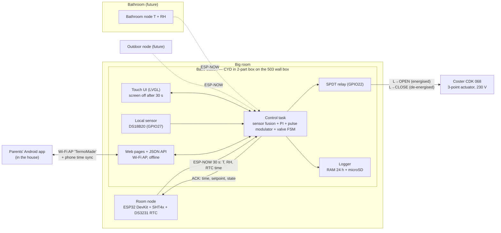

# 03 — System architecture

## Overview

## Node responsibilities

| Node | Does | Does **not** do |
|---|---|---|
| **Base (CYD)** | All state and settings, sensor fusion, controller, relay, UI, logging, Wi-Fi AP + web/API, system time, node registry, pairing | — |
| **Room node** | Reads SHT4x every 30 s, keeps the **battery-backed RTC**, sends telemetry incl. RTC time, sets its RTC when the base has fresher phone time, blinks LED on ACK | Any control decision. It stays "dumb" |
| **Android app** | Connects to the base's AP, shows the simple control page, pushes phone time to the base | Stores no state. The base is the source of truth |
| **Bathroom node** (future) | Like the room node, role = BATHROOM | — |
| **Outdoor node** (future) | Deep sleep, wake every 5 min, send T + battery | — |

All sensor nodes run **the same firmware**. The role is assigned at pairing time and stored in
the base's registry. Hardware options (RTC present, sensor type) are detected at boot.

## Data flow

1. The room node reads the SHT4x and its RTC and sends a `TELEMETRY` frame (ESP-NOW unicast).
2. The base's receive callback copies it into a FreeRTOS queue.
3. The **control task** (1 Hz loop, controller tick every 30 s):
   - reads the local DS18B20 (every 30 s, non-blocking conversion)
   - updates the node registry (last seen, RSSI, values)
   - **fuses** the room temperature ([04 §1](04-control-algorithm.md#1-measurement--sensor-fusion))
   - resolves the active setpoint (mode + schedule + wall time)
   - PI → demand `u` → pulse modulator → **valve FSM** → relay
   - answers with an `ACK` (time, setpoint, control temp, valve state)
4. Logger: every 60 s into the RAM ring buffer (24 h) + daily CSV on microSD.
5. UI, web and app read a **state snapshot** (mutex). They only send *requests* (setpoint, mode,
   boost, schedule edit, time sync), which the control task validates.

## Time (no internet)

Schedules need wall time, and power cuts happen in the mountains. Sources, best first:

| Source | Quality | When |
|---|---|---|
| Phone (app/web page load) | Best (network time on the phone) | Whenever someone opens the app. Also written back to the room node's RTC if drift > 2 s |
| Room node DS3231 RTC (±2 ppm, CR2032 backup) | Good, ~1 min/year | After any reboot of the base, within 30 s |
| Base internal clock | Good while powered | Between syncs |
| None | — | Schedule suspended → setpoint = Comfort, clock icon blinks |

Time zone `CET-1CEST,M3.5.0,M10.5.0/3` (Europe/Rome, automatic DST).

## Control temperature & room policies

The house is one zone (one valve). The **big room** has two sensors (room node + CYD). The
bathroom gets its own later.

| Policy | Control temperature | Use |
|---|---|---|
| `FUSED` (default) | Weighted mix of room node and CYD sensor (CYD offset learned) | Normal |
| `ROOM_ONLY` / `BASE_ONLY` | One sensor | Diagnostics / automatic fallback |
| `COLDEST` (future) | min over big room and bathroom | e.g. mornings: bathroom must be warm |

## Operating modes

| Mode | Setpoint | Notes |
|---|---|---|
| `AUTO` (default) | From the weekly schedule: **Comfort** by day, **Night** at night | Needs valid time, else Comfort |
| `COMFORT` | e.g. 20.0 °C | Manual, until changed |
| `NIGHT` | e.g. 17.0 °C | Manual, until changed |
| `AWAY` | Antifreeze, e.g. 7 °C | House empty |
| `OFF` | — | Valve closed immediately. **Antifreeze still active** (configurable) |
| `BOOST` | — | Continuous ON for 30/60/120 min, then back. OFF_MIN lockout still respected |
| `CLASSIC` (test) | as AUTO | Classic ±0.2 °C thermostat behaviour, used only for A/B comparison days |

Plus an optional **central-plant schedule** (condo heating hours): outside it, no pulses and the
integrator is frozen.

## Failure modes & reactions

| Failure | Detection | Reaction |
|---|---|---|
| Room node silent | No frame for `STALE_S` = 300 s | Use the CYD sensor alone, with its last learned offset. Alarm icon |
| CYD sensor fails | DS18B20 CRC errors / missing | Room node alone. Alarm icon |
| Both lost | — | **LIMP**: open-loop pulses at the learned steady-state duty (`I`), capped at 0.30 (0.15 if never learned). Alarm. `FAIL_OFF` selectable |
| Implausible reading | T outside 0…40 °C or step > 2 °C/30 s | Discarded. Three in a row = sensor failure |
| Base crash / reboot | Watchdog, brown-out | Relay drops → valve driven closed. Boot in OFF_MIN lockout. State restored from NVS, time from the room node's RTC |
| Time unknown | No RTC frame, no phone sync | Schedule suspended → Comfort. Logs use uptime and are re-stamped later |
| Continuous ON very long | Valve open > 4 h | Warning (sensor in a cold spot?), daily budget alarm |
| microSD missing/full | Mount/write error | RAM log only, icon |
| Valve doesn't move | Not detectable (no position feedback used: the aux microswitch belongs to the meter) | — The room temperature trend is the indirect check |

**Emergency fallback:** keep the old thermostat. If the box fails, unscrew it and reconnect the
old thermostat's three wires (C / open / close).

## Network

**AP only.** SSID `TermoMade` (WPA2), fixed channel 1, base at `192.168.4.1`, mDNS
`termomade.local`. ESP-NOW runs on the same channel. If the house ever gets internet, an STA mode
(NTP, MQTT/Home Assistant, remote access) can be added later without changing the protocol.
