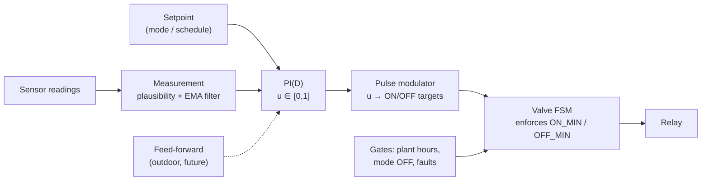
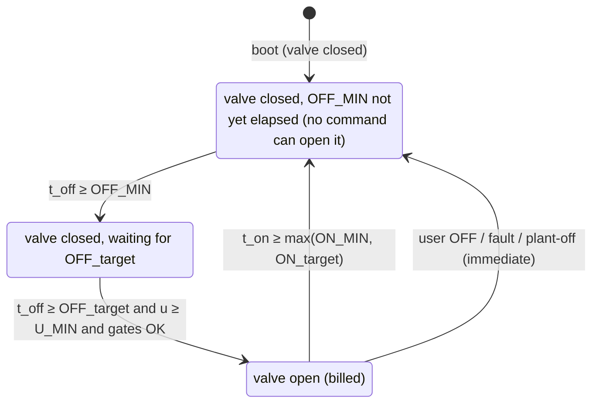

# 04 — Control algorithm (specification)

The firmware must implement exactly this. The Python reference implementation lives in
`tools/sim/thermal_sim.py` (`PID`, `PulseModulator`, `TermoMade`), so firmware and simulator
can be checked against each other.

## Layers



`u` is the **demand**: the fraction of time the valve should be open (duty), from 0 to 1.

## 1. Measurement & sensor fusion

- Room node telemetry every 30 s (SHT4x, 0.01 °C). CYD local DS18B20 read every 30 s
  (12-bit, 0.0625 °C).
- **Plausibility:** reject T < 0 °C or > 40 °C, or |ΔT| > 2 °C between consecutive readings.
  Three rejections in a row = sensor failure.
- **Calibration offset** per sensor, set in the UI against a reference thermometer. The room node
  is the reference by default.
- **Learned CYD offset.** The CYD sensor sits in a box with a PSU and an ESP32, so it reads warm by
  a slowly varying amount:
  ```
  if both valid and |dT_room/dt| < 0.5 °C/h:          # quasi-steady only
      off_b += dt/(τ_off+dt) · ((T_base − T_room) − off_b)     τ_off = 6 h
  T_base_corr = T_base − off_b
  ```
  `off_b` is persisted to NVS hourly. Watch it on the diagnostics screen. If it moves a lot with
  the backlight on/off, the sensor chamber needs work.
- **Fusion** (policy `FUSED`): `T = w_r·T_room + (1 − w_r)·T_base_corr`, `w_r = 0.7` default.
  Two sensors in different spots of the big room give a better room average and halve the
  uncorrelated noise.
- **Fallback:** room node lost → `T = T_base_corr` (frozen `off_b`). CYD sensor lost →
  `T = T_room`. Both lost → LIMP (§6).
- **EMA filter** with τ_f = 120 s on the fused value: `Tf += dt/(τ_f+dt) · (T − Tf)`.
- Other policies (bathroom etc.) in [03](03-architecture.md#control-temperature--room-policies).

## 2. PI(D) → demand u

Runs every `TS` = 30 s (fixed tick, real `dt` from a monotonic clock).

```
if SP < SP_prev:  coast = true          # setpoint decreased (e.g. Comfort → Night)
e  = SP − Tf
if e ≥ 0:         coast = false         # room has cooled down to the new setpoint
P  = Kp · e
D  = −Kp · Td · dTf/dt                  # derivative on measurement, low-pass τ = Td/4; Td = 0 by default
u_unsat = P + I + D
if |e| ≤ I_BAND and not coast and not (u_unsat ≥ u_max and e > 0):
    I += Kp · dt / Ti · e               # integrate only near the setpoint
I  = clamp(I, 0, 1)
u  = clamp(P + I + D, 0, u_max)         # u_max = 1, or uc during efficient recovery (§5)
```

- **`I` has a physical meaning:** the duty needed in steady state (the "learned load"). It is
  shown on the diagnostics screen and **persisted to NVS every 30 min** and on mode changes, so a
  power cut does not throw the learning away.
- **Integration band** `I_BAND` = 1.0 °C: no integration on big errors (cold arrival, sun, setback).
  In simulation this cut the cold-arrival overshoot from 0.43 to 0.28 °C with identical
  steady-state results.
- **Coast:** after a setpoint *decrease* the room needs hours to cool down. Without coasting, `I`
  would integrate that negative error and drain the learned load to 0 every night. That makes
  the morning sluggish.
- **Setpoint change:** no derivative kick (D is on the measurement). `I` is kept, so the change is
  bumpless.
- **Mode `AWAY` ↔ `COMFORT`:** keep one `I` per setpoint band (≤ 12 °C vs > 12 °C). The antifreeze
  load is very different from the comfort load. Comfort ↔ Night share one `I`.
- **Integration gated off** when: central plant off, valve forced closed (mode OFF, fault), LIMP
  mode, or BOOST.

## 3. Pulse modulator: u → (ON target, OFF target)

```
uc = ON_MIN / (ON_MIN + OFF_MIN)               # 3/(3+5) = 0.375

u <  U_MIN   (0.03)  → no pulses              (ON —,      OFF ∞)
u ≤  uc              → pulse-FREQUENCY         (ON = ON_MIN, OFF = ON_MIN·(1−u)/u)
u <  U_CONT  (0.90)  → pulse-WIDTH             (ON = OFF_MIN·u/(1−u), OFF = OFF_MIN)
u ≥  U_CONT          → continuous              (ON ∞,      OFF = OFF_MIN)
```


| u | ON | OFF | Period | Pulses/h |
|---|---|---|---|---|
| 0.05 | 3.0 | 57.0 | 60.0 | 1.0 |
| 0.10 | 3.0 | 27.0 | 30.0 | 2.0 |
| 0.15 | 3.0 | 17.0 | 20.0 | 3.0 |
| 0.20 | 3.0 | 12.0 | 15.0 | 4.0 |
| 0.30 | 3.0 | 7.0 | 10.0 | 6.0 |
| 0.375 | 3.0 | 5.0 | 8.0 | 7.5 |
| 0.50 | 5.0 | 5.0 | 10.0 | 6.0 |
| 0.70 | 11.7 | 5.0 | 16.7 | 3.6 |
| 0.80 | 20.0 | 5.0 | 25.0 | 2.4 |
| ≥ 0.90 | continuous | — | — | — |

(minutes; with ON_MIN = 3, OFF_MIN = 5)

Why this shape: a fill minute buys 3–4× more heat than a keep-open minute ([02](02-heating-physics.md#2-hot-water-in-the-radiators-is-stored-energy-youve-already-paid-for)).
So the modulator **varies frequency first** and stretches ON only when OFF has reached its minimum.

## 4. Valve FSM (the only owner of the relay)

Relay mapping for the 3-point Coster CDK 068: relay **energised** = L on **OPEN** (valve opens),
**de-energised** = L on **CLOSE** (valve closes). The actuator's own limit switches stop the motor
at the ends. The motor takes ~60 s per move, and flow starts around mid-stroke (~30 s).



Rules:

1. Targets are **re-evaluated every tick** from the current `u`. If the room cools faster, the OFF
   wait shortens (but never below OFF_MIN). If it warms up during a pulse, the pulse still
   completes ON_MIN (the circuit is filled; stopping early saves almost nothing and adds a cycle).
2. **OFF_MIN is absolute.** BOOST, manual ON and setpoint changes all wait for the lockout to
   finish (UI shows "opens in 2:10"). The lockout also applies right after boot, because the
   valve's state before the reboot is unknown.
3. **ON_MIN** applies to every automatic close. Only user OFF, faults and plant-off close earlier.
4. `MAX_CYCLES_PER_HOUR` (default 8) is an extra wear guard: if reached, the next OFF is
   stretched.
5. Every transition is logged with timestamp, reason, `u`, P, I, targets.
6. **Billed-time counter:** accumulate relay-energised seconds. The meter most likely counts from
   the actuator's mid-stroke aux switch, so its ~30 s delay on opening and on closing roughly
   cancels. Daily total persisted at midnight and every 10 min.

Fixes against the legacy sketch: no `forceEvaluate` that toggles regardless of direction, no
forced minimum duty when the room is too warm, and FSM and relay can never disagree
([11](11-legacy-review.md)).

## 5. Recovery: cold start, morning, boost

No special mode is needed to heat a cold house. With Kp = 0.6, an error ≥ 1.5 °C gives P ≥ 0.9,
so the valve stays continuously open. As the error shrinks, `u` drops below U_CONT and
pulse-width, then pulse-frequency, take over. Simulated overshoot after an 8 → 20 °C arrival:
**0.28 °C** (classic thermostat 0.73 °C).

**But continuous ON is the expensive regime under time billing:** the circuit is full, hot water
goes back to the plant, ≈ 0.13 kWh per billed minute instead of ≈ 0.47. Hence two recovery
styles:

| Recovery | Rule | Default for |
|---|---|---|
| **EFFICIENT** | After a setpoint increase, `u_max = uc` (pulse-frequency only, never longer pulses or continuous) until the room is within 0.3 °C. Combined with **optimum start** (begin earlier) | Scheduled Night → Comfort |
| **FAST** | `u_max = 1` (continuous allowed) | Away → Comfort (arrival), BOOST button |

Night setback simulation (Comfort 20 °C 06:30–22:30, outdoor −2 °C; `tools/sim`, section NIGHT
SETBACK):

| Strategy | Billed min/day | Room at 06:30 | Room at 07:30 |
|---|---|---|---|
| Pulse, no setback | **177** | 20.1 | 20.0 |
| Pulse, night 17 °C, fast recovery | 251 (+42 %) | 16.9 | 19.1 |
| Pulse, night 17 °C, efficient, start 2 h early | 212 (+20 %) | 19.3 | 19.5 |
| Pulse, night 18.5 °C, fast | 192 (+8 %) | 18.4 | 19.7 |
| **Pulse, night 18.5 °C, efficient, start 1 h early** | **189 (+7 %)** | **19.6** | **19.8** |
| *Classic thermostat, no setback (≈ today)* | *254* | *20.2* | *20.3* |
| *Classic thermostat, night 17 °C* | *344* | *16.8* | *19.6* |

The model is a heavy building (walls ≈ 2-day time constant), so the night saves only ~3–4 % of
the heat, while the morning recovery costs billed minutes at the worst rate. **Under time
billing a night setback costs money unless it is shallow and recovered efficiently.** Default
plan: Night = 18.5 °C, EFFICIENT recovery, optimum start. If cooler nights matter more than
cost, go to 17 °C and accept ≈ +20 %. Real data will tell: log both for a week each.

The **BOOST** button is a user override (timed continuous ON) and does not touch `I`.

## 6. Fallback / LIMP

Chain: fused → room node only → CYD sensor only (frozen learned offset) → LIMP.
When no valid control temperature exists ([03](03-architecture.md#failure-modes--reactions)):
`u = clamp(I_learned, 0.05, 0.30)`, or 0.15 if `I` was never learned. The modulator and FSM run
as usual. Alarm on screen, LED purple, short beep every 10 min. `FAIL_OFF` policy is available
for summer or if you prefer. Default = LIMP, because an unattended mountain house must not freeze.

## 7. Parameters (defaults)

| Name | Default | Range | Notes |
|---|---|---|---|
| `ON_MIN` | 180 s | 60–600 | Circuit fill time. Measure it (Phase 0) |
| `OFF_MIN` | 300 s | 180–1800 | Valve close + stabilisation |
| `TS` | 30 s | — | Controller tick |
| `TAU_F` | 120 s | 30–600 | Measurement EMA |
| `KP` | 0.6 /°C | 0.2–1.5 | Duty per °C of error |
| `TI` | 120 min | 30–300 | Integral time |
| `TD` | 0 | 0–20 min | Off by default (sim: no benefit) |
| `U_MIN` | 0.03 | 0–0.1 | Below this: no pulses |
| `U_CONT` | 0.90 | 0.8–1.0 | Above this: continuous |
| `I0` | 0.15 | 0–1 | Initial learned duty (first boot only) |
| `STALE_S` | 300 s | 120–900 | Node considered lost |
| `LIMP_U` | learned I clamped 0.05–0.30 | — | Fallback demand |
| `MAX_CYCLES_PER_HOUR` | 8 | 4–12 | Wear guard |
| `SP_COMFORT` / `SP_NIGHT` / `SP_AWAY` | 20.0 / 18.5 / 7.0 °C | 5–25 | Setpoints are always clamped to 5–25 °C. Night 18.5 trade-off in §5 |
| `I_BAND` | 1.0 °C | 0.3–3 | Integrate only when abs(e) ≤ I_BAND |
| `RECOVERY_SCHED` / `RECOVERY_ARRIVAL` | EFFICIENT / FAST | — | §5 |
| `PREHEAT_MAX` | 3 h | 0–6 h | Optimum-start limit. Fixed 1 h until learned |
| Default schedule | Comfort 06:30–22:30, Night otherwise | — | Weekly, up to 4 slots/day, copy-day function |
| `W_ROOM` | 0.7 | 0–1 | Fusion weight of the room node vs the CYD sensor |
| `TAU_OFF` | 6 h | 1–24 h | Learning time constant of the CYD sensor offset |
| `CONT_WARN_S` | 4 h | — | Continuous-ON warning |
| `BUDGET_MIN_DAY` | 0 (off) | — | Daily billed-minutes alarm |

All parameters can be edited from the web UI "Advanced" page (and the CYD diagnostics screen),
are stored in NVS, and are logged in the CSV header when they change.

## 8. Tuning procedure (on site)

1. **Measure the fill time** (Phase 0): touch the far radiator's return pipe, or better, log a
   DS18B20 on it. Time from valve command to the moment the return gets hot = `ON_MIN`.
2. Start with the defaults. Run 3 days.
3. Read the diagnostics: if `I` keeps drifting for days, Ti is fine. If the temperature
   oscillates with a period of hours, increase `TI` (150–180 min). If recovery after setpoint
   steps is slow, increase `KP` (0.8).
4. If the room ripples more than ±0.3 °C in mild weather: that is the fill-quantum limit. Consider
   a shorter `ON_MIN` on mild days (future "partial fill").
5. Feed the logs into the simulator (`tools/sim`) to calibrate the plant model, then re-tune there
   first.

## 9. Planned extensions

- **Outdoor feed-forward** (needs outdoor node): `u = u_ff + PI`, with
  `u_ff = K_ff · max(0, SP − T_out)`. `K_ff` is learned slowly as EMA of `I/(SP − T_out)` during
  stable periods. Faster reaction to weather changes, smaller `I` swings.
- **Adaptive fill time** (needs pipe node): end each pulse when the return pipe temperature rises
  by more than 10 K over its pre-pulse value (hot front arrived), bounded to
  [ON_MIN_LOW, ON_MIN_HIGH]. Learn the median as `ON_MIN`.
- **Plant-off detection** (pipe node): supply < 35 °C after 60 s open → close, pause pulses for
  15 min, freeze `I`.
- **Overshoot learning** after continuous-ON periods: lower `U_CONT` exit margin if overshoot
  repeats.
- **Optimum start** (works offline): learn the morning warm-up rate (°C/h, vs outdoor temperature
  when the outdoor node exists) and start the Night → Comfort transition early enough that the
  room is at Comfort *at* the scheduled time, not 1–2 h later. Same for a planned
  `AWAY → COMFORT` date entered before leaving ("we arrive Friday 18:00").
