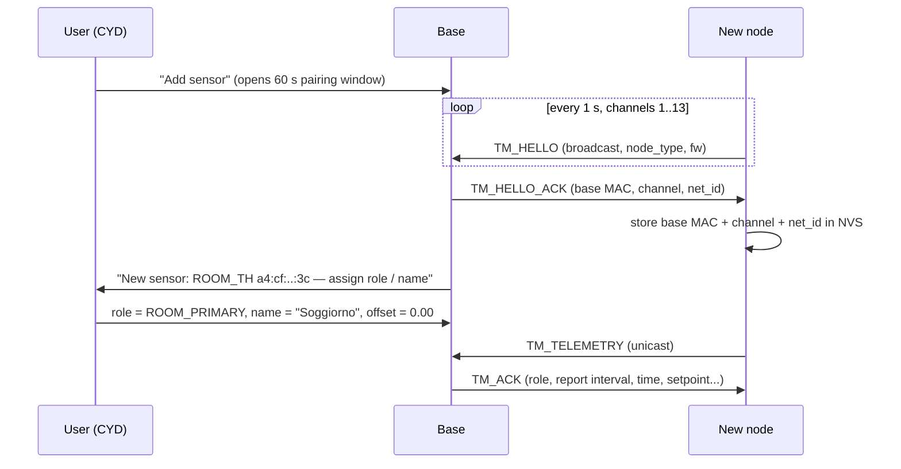
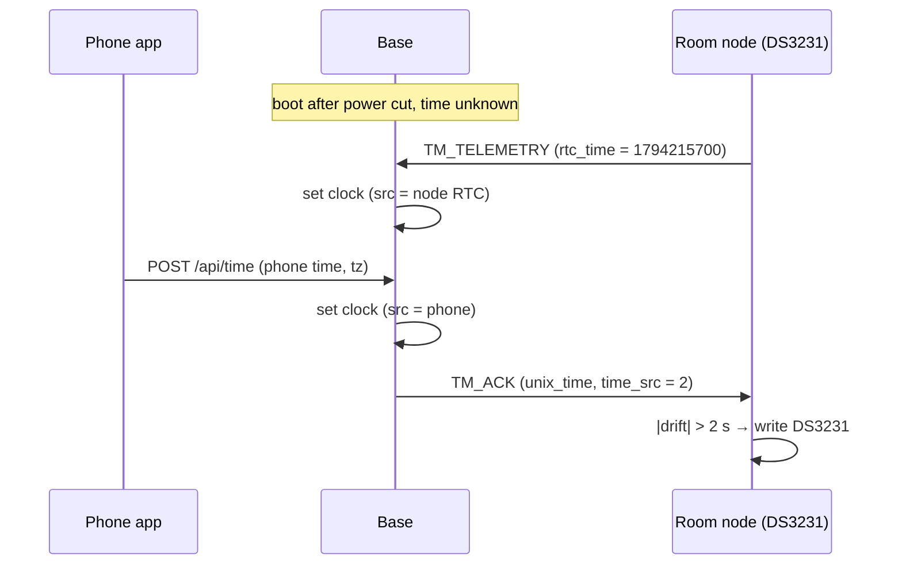

# 06 — Communication (ESP-NOW protocol)

## Why ESP-NOW

| Option | Verdict |
|---|---|
| **ESP-NOW** | ✅ No router needed, ms latency, MAC-level ACK, works next to the base's Wi-Fi AP/STA, low power for battery nodes, up to 20 peers |
| Wi-Fi + HTTP/MQTT | Needs the base AP or a router to be up and joined. Slower and heavier for battery nodes |
| BLE | Shorter range, more complex on the base next to Wi-Fi + display |

## Frame format (protocol v1)

Implemented in `firmware/lib/tm_protocol/src/tm_protocol.h` (namespace `tmp`; the names below
are the doc's). All frames are packed little-endian structs and stay **≤ 250 bytes** (ESP-NOW v1 limit, so every
chip and IDF version can talk). The node's **MAC address** (from `esp_now_recv_info_t.src_addr`)
is its identity. Each frame starts with a common header:

```c
#pragma pack(push, 1)
typedef struct {
  uint16_t magic;      // 0x4D54 ("TM")
  uint8_t  version;    // 1
  uint8_t  type;       // TmMsgType
  uint8_t  net_id;     // house/network id (configurable, ignores foreign systems)
  uint8_t  flags;      // bit0 = request ACK payload, bit1 = low battery, ...
  uint16_t seq;        // per-sender counter, detects lost/duplicate frames
} TmHeader;            // 8 bytes

typedef struct {
  uint8_t  kind;       // TmKind: AIR_T, RH, PIPE_SUPPLY_T, PIPE_RETURN_T, OUTDOOR_T, ...
  uint8_t  index;      // channel index when a node has several of the same kind
  int16_t  value;      // scaled: temperatures ×100 °C, RH ×100 %, voltage mV
} TmReading;           // 4 bytes

typedef struct {
  TmHeader  h;          // type = TM_TELEMETRY
  uint8_t   node_type;  // hardware type (ROOM_TH, OUTDOOR, PIPE, ...)
  uint8_t   fw_major, fw_minor;
  uint8_t   status;     // sensor error bits
  uint16_t  battery_mv; // 0 = USB powered
  uint16_t  uptime_min;
  uint32_t  rtc_time;   // unix time from the node's DS3231, 0 = no RTC / invalid
  uint8_t   count;      // number of readings (≤ 16)
  TmReading r[16];
} TmTelemetry;          // 21 + 4·count bytes

typedef struct {
  TmHeader  h;          // type = TM_ACK
  uint32_t  unix_time;  // 0 = base has no valid time
  uint8_t   time_src;   // 0 none, 1 node RTC, 2 phone (best). Node sets its RTC if src = 2 and drift > 2 s
  uint8_t   role;       // role assigned by the base (ROOM_PRIMARY, BATHROOM, OUTDOOR, PIPE, ...)
  uint8_t   report_s;   // requested report interval
  int16_t   setpoint;   // ×100 °C
  int16_t   control_t;  // ×100 °C, INT16_MIN = unknown
  uint8_t   valve;      // 0 closed, 1 open, 2 lockout
  uint16_t  next_s;     // seconds to next valve action, 0xFFFF = none
  uint8_t   mode;
  uint8_t   alarms;     // low byte of the controller alarm bits
} TmAck;
#pragma pack(pop)
```

Message types: `TM_HELLO` (node → broadcast, pairing/discovery), `TM_HELLO_ACK` (base → node:
base MAC, channel, net_id), `TM_TELEMETRY`, `TM_ACK`, `TM_CMD` (base → node, e.g. "identify:
blink", "reboot", "enter OTA"), later `TM_LOG` (node diagnostics).

Rules:

- Receivers **ignore** frames with the wrong magic, a different `net_id`, an unknown major
  `version`, or a length that doesn't match `count`.
- **Adding a new reading kind never breaks old firmware.** Unknown kinds are skipped.
- A breaking change bumps `version`. The base accepts v1 and v2 during migration.
- One shared header file (`firmware/lib/tm_protocol/`) is used by every firmware, so the structs
  can never drift apart.

## Pairing



- Outside the pairing window, HELLOs from unknown MACs are ignored, so neighbours' devices are
  never adopted.
- The registry (MAC → role, name, offset, weight, last values) lives in the base's NVS.
  Up to 19 nodes.
- **Encryption** (optional, Phase 4): ESP-NOW supports per-peer LMK keys (up to 17 encrypted peers).
  The key would be generated by the base and handed over during pairing. For a home thermostat,
  `net_id` + pairing window is the MVP.

## Channel handling

The house has no internet, so the base runs **AP only on a fixed channel** (default 1, configurable
in Settings). Nodes use the channel they stored at pairing. ESP-NOW and the AP share the radio
without problems.

*If an STA mode (home router) is ever added:* the channel would follow the router. Nodes
would then rescan channels 1–13 after 3 consecutive send failures (HELLO on each channel until the
base answers), and the base would disable modem power-save (`WIFI_PS_NONE`) so it doesn't miss
frames.

## Time distribution



## Timing & reliability

| Item | Value |
|---|---|
| Room/bathroom report interval | 30 s |
| Outdoor report interval | 300 s (deep sleep) |
| Pipe node | 10 s while the valve is open (base tells it via ACK), 60 s otherwise |
| Delivery | Unicast with MAC-level ACK + up to 3 app retries (100 ms apart) |
| Staleness | No frame for `STALE_S` (300 s) → node "lost" (fallback chain) |
| Link quality | Base records RSSI per frame (`rx_ctrl.rssi`) → bars on screen |

## API gotchas (Arduino-ESP32 core 3.x / ESP-IDF 5.x)

- **Receive callback signature** is
  `void cb(const esp_now_recv_info_t *info, const uint8_t *data, int len)`. The MAC is
  `info->src_addr`, RSSI `info->rx_ctrl->rssi`. `info` is only valid inside the callback.
- **Send callback signature changed in ESP-IDF 5.5** (Arduino core 3.3.x):
  `void cb(const esp_now_send_info_t *tx_info, esp_now_send_status_t status)`, where
  `esp_now_send_info_t` is `wifi_tx_info_t`. Older examples that take `const uint8_t *mac` won't
  compile. Pin the core version and use the header as the source of truth.
- Callbacks run in the Wi-Fi task. Copy into a FreeRTOS queue and return.
- ESP-NOW v2 (IDF ≥ 5.4) allows 1470-byte payloads. Don't rely on it while 250 B is enough.
- Call `esp_now_init()` **after** `WiFi.mode(...)` and set the channel before adding peers.

## Base ↔ phone (Wi-Fi)

HTTP JSON API + web pages served by the base on its own AP. The parents' Android app wraps them
([12](12-android-app.md)), and any browser works too ([07](07-user-interface.md#web-ui)). No
internet involved. If the house ever gets internet: MQTT / Home Assistant discovery can be added.
