# 07 — User interface

Users: **Andrea** (setup, tuning, diagnostics) and **his parents** (daily use: see temperature,
warmer/colder, day/night/away, arrival). Everything on the CYD is **Italian** (D15), including
the hidden pages, so the parents can also set the clock after a long power cut. Firmware
parameter names stay in English (they are code names). Code, logs and docs are in English.

## CYD touch screen (320×240, landscape)

Drawn directly with LovyanGFX (`src/base/ui.cpp` Home, `src/base/ui_menu.cpp` hidden pages).
The screenshots below are rendered **from the real firmware code** on a PC by
`tools/ui_preview/build.sh` (same fonts and layout as the device; colours on the real panel
depend on the TM_LCD flags, see `firmware/README.md`).

### Screen power and brightness

- **Backlight fully off after 30 s without touch** (10–255 s, page SCHERMO). 120 s while a hidden
  page is open. Dark room at night.
- **The first touch only wakes the screen** and is never taken as a button press, so you can't
  change the setpoint by accident in the dark. A press needs two consecutive touch samples
  (~30 ms): single-sample blips are ignored.
- **Auto-brightness (default on):** the CYD's own light sensor (LDR, GPIO 34, front, left of the
  display) is read every 2 s **while the screen is dark** (the backlight would otherwise light up
  the sensor). On wake-up the backlight is set between "Luminosita al buio" (12) and "Luminosita
  massima" (180) according to the room light. The light scale learns itself from the brightest
  and darkest readings of the last days. Needs the LDR hole in the front of the box
  ([13](13-enclosure.md), `ldr_hole`).
- No other light: the RGB LED is on the back and stays off.

### Home (the only screen the parents need)

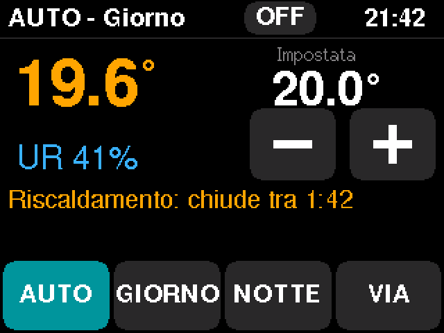 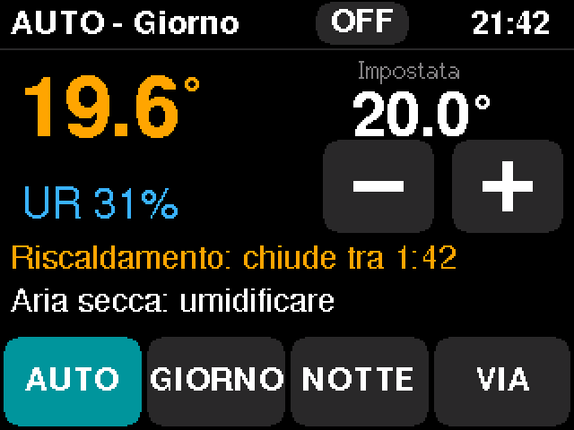

- Big number: room temperature (orange while the valve is open). Under it the humidity.
- **Impostata**: the setpoint. −/+ step 0.5 °C, auto-repeat when held, shown immediately and
  confirmed by the controller within 1 s. In AUTO it is a temporary override until the next
  schedule change; in GIORNO/NOTTE/VIA it changes that mode's temperature (saved 10 s after the
  last change). VIA is capped at 12 °C. Disabled in OFF.
- Top bar: mode (`AUTO - Giorno`, `(pre)` = morning preheat, `*` = override, `BOOST 42'`,
  `AUTO - ARRIVO 52'`) and the clock (`--:--` in red when the time is not set).
- Valve line: `Riscaldamento: chiude tra m:ss`, `Riscaldamento continuo`,
  `In pausa: prossimo impulso tra m:ss`, `Pausa valvola: riapre tra m:ss` (OFF_MIN lockout),
  `Nessuna richiesta di calore`, `Avvio: attendo i sensori...`, `Riscaldamento spento`,
  `Arrivo: riscaldo al massimo, NN min`, `Arrivo: la valvola apre tra NN s`.
- Red banner (highest first): `EMERGENZA: nessun sensore valido` (LIMP),
  `Sensore stanza non risponde`, `Sensori in disaccordo`, `Ora non impostata`,
  `Valvola aperta da molto tempo`, `Superato il budget giornaliero`. Otherwise the humidity advice
  `Aria secca: umidificare` (< 35 %) / `Aria umida: arieggiare` (> 60 %).
- Mode buttons AUTO / GIORNO / NOTTE / VIA. **OFF** is a small button in the top bar: the first
  tap turns it red (`OK?`), a second tap within 3 s switches the heating off (antifreeze stays
  active). It stays red while off; any mode button or ARRIVO switches the heating back on.
- No accented letters on screen (the built-in fonts are 7-bit).

### ARRIVO (arriving at the cold house)

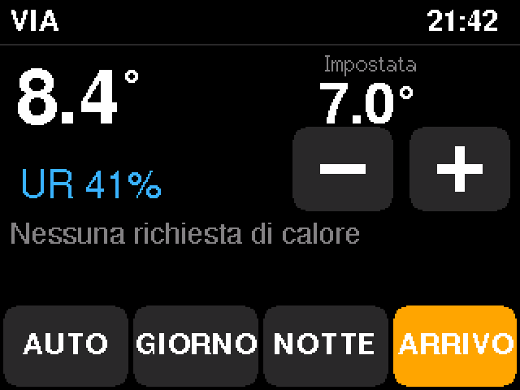 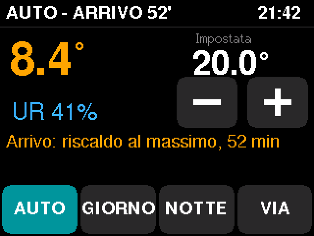

While the house is in **VIA** (or SPENTO) the VIA button becomes an orange **ARRIVO** button.
Leaving: press VIA. Arriving: press ARRIVO in the same place. ARRIVO switches to AUTO and opens
the valve fully for **60 min** (stops earlier once the room is within 2 °C of the setpoint), then
normal pulses with efficient recovery. Why 60 minutes and why it can't make a 7 °C house warm in
an evening: [04 §5.1](04-control-algorithm.md#51-arrivo-arriving-at-the-cold-house-decided-2026-11-09-with-toolssimarrival_studypy).
Pressing AUTO or GIORNO instead also ends VIA, without the forced hour.

## Hidden settings (long-press the clock 2 s)

Hold the clock (top right of Home) for **2 seconds**. Eight pages; **<** and **>** in the header
move between pages, the red **X** returns to Home (the screen timeout also returns to Home).
Values change with **−** / **+** (hold for auto-repeat). Every change is sent to the control task,
which checks and clamps it (same limits as the console), applies it at once and **saves it to
NVS 10 s after the last change**. Buttons marked † need a **second tap within 3 s** (the label
turns red: `CONFERMI?`).

### 1 STATO — everything at a glance

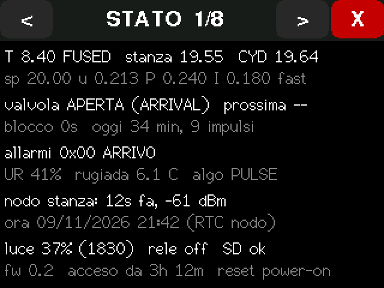

| Line | Meaning |
|---|---|
| `T 19.60 FUSED stanza 19.55 CYD 19.64` | Control temperature and its source (FUSED / ROOM / BASE / NONE), room node, CYD sensor after correction |
| `sp u P I` + `cst` `eff` `fast` | Setpoint, PI demand u (0–1), P and I terms; `cst` = I frozen after a setpoint decrease; `eff`/`fast` = recovery running |
| `valvola APERTA (PULSE) prossima 102s` | Valve state, why (`PULSE`, `CONT`, `BOOST`, `ARRIVAL`, `LIMP`, `CLASSIC`, `USER_OFF`, `PLANT_OFF`, `FAULT`, `CYCLE_LIMIT`, `BOOT`, `TARGET`, `NO_DEMAND`), seconds to the next change |
| `blocco 0s oggi 34 min, 9 impulsi` | OFF_MIN lockout left; billed minutes and pulses today (reset at midnight and at reboot) |
| `allarmi 0x00` + `LIMP BOOST ARRIVO` | Alarm bits: 1 room lost, 2 CYD sensor lost, 4 no sensor, 8 disagreement, 16 time unknown, 32 open too long, 64 budget |
| `UR rugiada algo` | Humidity, dew point, algorithm (PULSE or CLASSIC on A/B days) |
| `nodo stanza: 12s fa, -61 dBm` | Room node: age of the last frame, signal strength |
| `ora ... (RTC nodo / manuale)` | Clock and its source |
| `luce 37% (1830) rele off SD ok` | Room light, relay output, SD card |
| `fw acceso da reset` | Firmware version, uptime, reason of the last reset (power-on, PANIC, TASK-WDT, BROWNOUT…) |

### 2 DATA E ORA — manual time

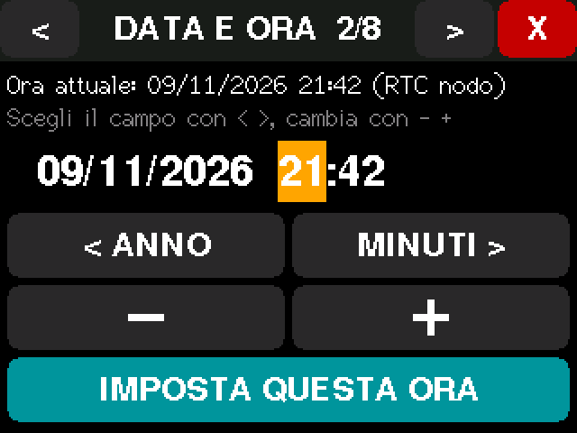

The CYD has **no battery-backed clock**. The time comes from the room node's DS3231 (every 30 s)
or is set by hand here (later: from the phone). After a power cut the base gets the time back
from the node within 30 s; set it here only if the node is missing or its coin cell is flat.

1. The editor starts from the current time (or the firmware build date if unknown), hours selected.
2. **< CAMPO / CAMPO >** choose the field (giorno, mese, anno, ore, minuti; orange = selected).
3. **− / +** change it (hold to repeat). Day is limited to the month's length.
4. **IMPOSTA QUESTA ORA** sets the clock (local Italian time; summer/winter time is automatic).
   Manual time is the best source: the node's DS3231 is corrected from it within 30 s and the
   node no longer overrides it. `Ora impostata!` confirms.

Console equivalent: `time 2026-11-09 21:30`.

### 3 TEMPERATURE

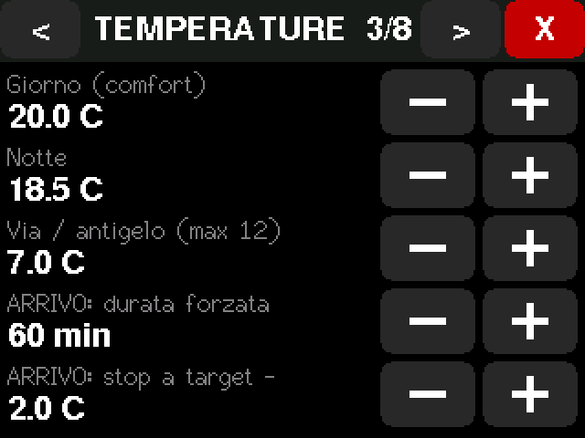

| Row | Parameter | Default | Range / step |
|---|---|---|---|
| Giorno (comfort) | `sp_comfort` | 20.0 °C | 5–25 / 0.5 |
| Notte | `sp_night` | 18.5 °C | 5–25 / 0.5 |
| Via / antigelo | `sp_away` | 7.0 °C | 5–12 / 0.5 (also used in SPENTO) |
| ARRIVO: durata forzata | `arrival_force_min` | 60 min | 0–240 / 15 (0 = ARRIVO only switches to AUTO) |
| ARRIVO: stop a target − | `arrival_stop_c` | 2.0 °C | 0.5–10 / 0.5 |

### 4 ORARIO — schedule (AUTO)

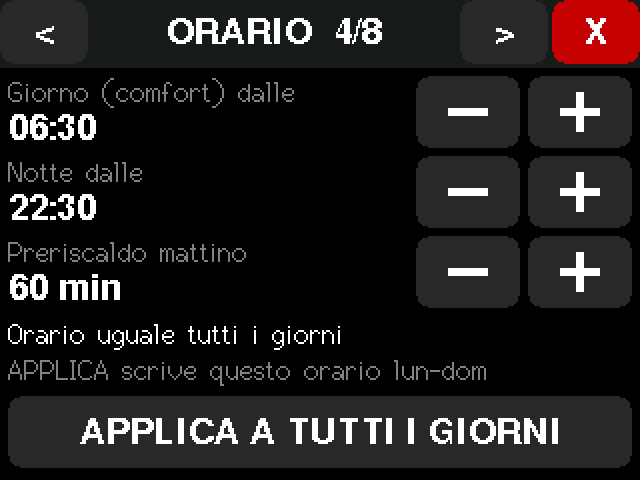

One rule for every day: **Giorno dalle** (Comfort starts) and **Notte dalle** (Night starts),
15-minute steps, plus **Preriscaldo mattino** (`preheat_min`, 60 min: Comfort's temperature is
used that long before "Giorno dalle", with efficient recovery). **APPLICA A TUTTI I GIORNI**
writes Monday–Sunday (highlighted when there are unsaved edits). If a per-day schedule was set
from the console, the page says `Ora: giorni diversi` and APPLICA replaces it. Per-day editing:
console `sched mon 07:00=C 23:00=N` (up to 4 slots per day), later the web page.

### 5 SENSORI

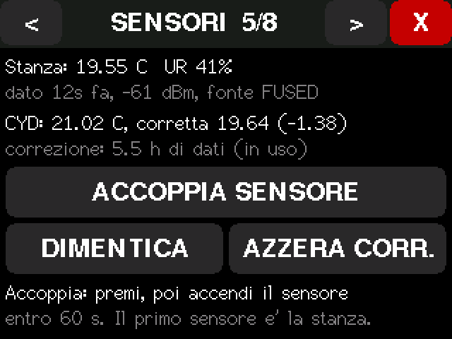

- Room node: temperature, humidity, age of the last frame, signal, fusion source.
- CYD sensor: raw, corrected, the correction, how many hours it has learned (`in uso` after 1 h of
  steady data with the screen off).
- **ACCOPPIA SENSORE**: opens pairing for 60 s; power or reset the node within that time. The
  first node paired becomes the room sensor (the next ones: bathroom).
- **DIMENTICA** †: forget all paired nodes (they must be paired again).
- **AZZERA CORR.** †: forget the learned CYD correction (after moving the box or the sensor).

### 6 SCHERMO

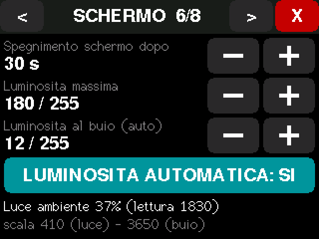

| Row | Default | Range / step |
|---|---|---|
| Spegnimento schermo dopo | 30 s | 10–255 / 5 |
| Luminosita massima | 180 | 10–255 / 10 |
| Luminosita al buio (auto) | 12 | 1–max / 2 |
| LUMINOSITA AUTOMATICA | SI | toggle (NO = always the maximum) |

The last line shows the room light (%), the raw reading and the learned scale.

### 7 AVANZATE — every control parameter

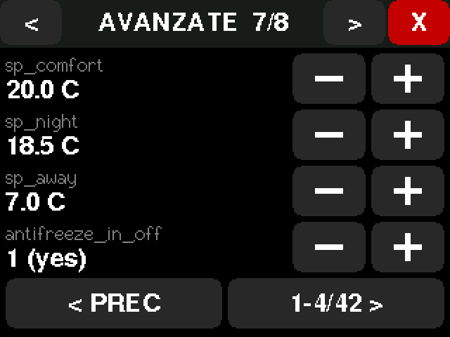 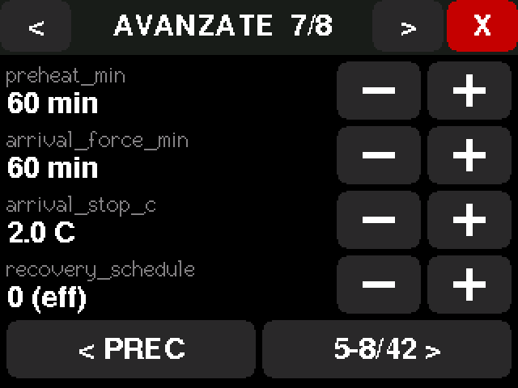

All 42 parameters, 4 per page (**< PREC / n-m/42 >** to scroll). Same names as the console
(`get`/`set`) and [04 §7](04-control-algorithm.md#7-parameters-defaults). Out-of-range values
are clamped. **Change these only if you know why**; `RIPRISTINO DI FABBRICA` restores all.

| Parameter | Default | Range | Step | Meaning |
|---|---|---|---|---|
| `sp_comfort` / `sp_night` / `sp_away` | 20 / 18.5 / 7 °C | 5–25 (away ≤ 12) | 0.5 | Setpoints (also on TEMPERATURE) |
| `antifreeze_in_off` | 1 | 0/1 | — | SPENTO still keeps `sp_away` (antifreeze) |
| `preheat_min` | 60 min | 0–360 | 15 | Morning preheat in AUTO |
| `arrival_force_min` | 60 min | 0–240 | 15 | ARRIVO forced heating |
| `arrival_stop_c` | 2.0 °C | 0.5–10 | 0.5 | ARRIVO stops forcing within this of the setpoint |
| `recovery_schedule` | 0 eff | 0/1 | — | Night → Comfort: 0 = pulses only, 1 = continuous allowed |
| `recovery_user` | 1 fast | 0/1 | — | After −/+ or a manual mode change |
| `recovery_arrival` | 0 eff | 0/1 | — | After ARRIVO's forced hour / leaving VIA or SPENTO |
| `recovery_done_c` | 0.3 °C | 0.05–2 | 0.1 | Recovery ends this close to the setpoint |
| `on_min_s` | 180 s | 60–900 | 10 | Minimum ON = circuit fill time |
| `off_min_s` | 300 s | 180–3600 | 10 | Minimum OFF, absolute (valve protection) |
| `max_cycles_per_hour` | 8 | 2–12 | 1 | Wear guard |
| `kp` | 0.6 /°C | 0.05–3 | 0.05 | Proportional gain (duty per °C) |
| `ti_s` | 7200 s | 600–21600 | 600 | Integral time |
| `td_s` | 0 s | 0–1800 | 60 | Derivative time (off) |
| `tf_s` | 120 s | 0–900 | 10 | Measurement filter |
| `i_band_c` | 1.0 °C | 0.2–5 | 0.1 | Integrate only within this error |
| `i0` | 0.15 | 0–1 | 0.01 | Starting duty before anything is learned |
| `u_min` / `u_cont` | 0.03 / 0.90 | 0–0.2 / 0.5–1 | 0.01 | No pulses below / continuous above |
| `tick_s` | 30 s | 5–120 | 5 | PI period |
| `stale_s` | 300 s | 60–1800 | 30 | Room node considered lost |
| `w_room` | 0.7 | 0–1 | 0.05 | Weight of the room node in the fusion |
| `tau_offset_s` | 21600 s | 600–172800 | 1800 | CYD correction learning time constant |
| `offset_learn_max_slope_c_h` | 0.5 °C/h | 0.05–5 | 0.1 | Learn only while the room is this steady |
| `offset_min_learn_s` | 3600 s | 0–86400 | 600 | Learning before the CYD sensor joins the fusion |
| `disagree_c` / `disagree_s` | 1.5 °C / 600 s | 0.3–10 / 60–7200 | 0.1 / 60 | Sensor disagreement alarm |
| `median3` | 1 | 0/1 | — | Median-of-3 spike filter |
| `fail_policy` | 0 limp | 0/1 | — | No sensor at all: 0 = LIMP (pulses at learned duty), 1 = valve closed |
| `limp_min` / `limp_max` / `limp_default` | 0.05 / 0.30 / 0.15 | 0–0.6 | 0.01 | LIMP duty limits |
| `algo` | 0 pulse | 0–2 | — | 0 = pulse, 1 = classic ±hysteresis, 2 = alternate days (A/B test) |
| `classic_hyst_c` | 0.2 °C | 0.05–2 | 0.05 | Classic thermostat hysteresis |
| `cont_warn_s` | 14400 s | 600–86400 | 1800 | "Valve open too long" alarm |
| `budget_min_day` | 0 (off) | 0–1440 | 10 | Daily billed-minutes alarm |
| `rh_low` / `rh_high` / `rh_hyst` | 35 / 60 / 3 % | 10–60 / low+5–95 / 0.5–10 | 1 / 1 / 0.5 | Humidity advice thresholds |

### 8 SISTEMA

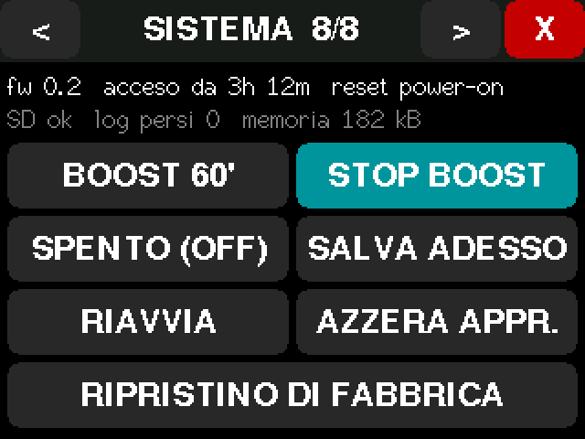 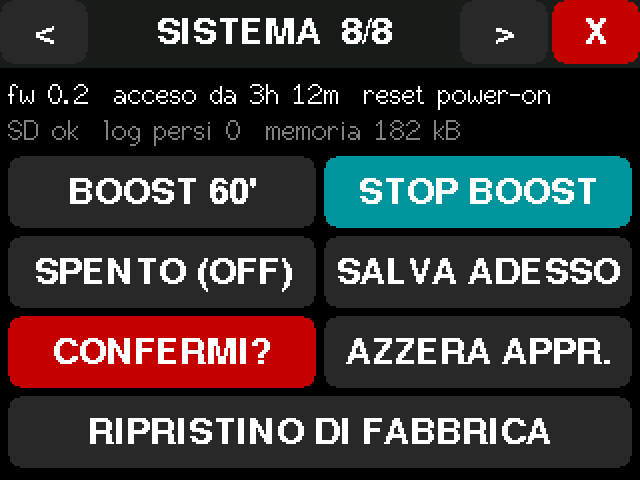

- Firmware, uptime, last reset reason; SD state, log lines lost, free memory.
- **BOOST 60'**: valve open for 60 min (respects the 5 min pause). **STOP BOOST**: ends a boost
  or ARRIVO's forced hour (teal while one is running).
- **SPENTO (OFF)**: heating off (antifreeze still active if `antifreeze_in_off`). Any mode button
  on Home switches it back on.
- **SALVA ADESSO**: write settings and learned state to NVS now (normally automatic).
- **RIAVVIA** †: save and restart (valve closes, 5 min pause after boot).
- **AZZERA APPR.** †: forget the learned duty and the CYD correction.
- **RIPRISTINO DI FABBRICA** †: erase all settings and paired nodes, restart with defaults.

### Planned screens (Phase 3)

| Screen | Content |
|---|---|
| Graph | 24 h / 6 h: control temperature, room node, CYD sensor (corrected), setpoint, valve bars |
| Stats | Today / yesterday / 7 days: billed minutes, pulses, mean temp, RMS error; season total vs last season |
| Schedule per day | Up to 4 slots/day, copy day → week (console `sched` already does it) |
| Planned return | "VIA fino al …": start heating before arriving (D23) |
| Wi-Fi | AP name/password/channel |

## Buzzer (GPIO 26, optional speaker)

Short beep on setpoint change (optional). Triple beep on alarms, repeated every 30 min, **only
between 08:00 and 21:00**, and it can be muted from the banner.

## Web page and JSON API (base v0.3)

Connect a phone or PC to the base's Wi-Fi (`TermoMade-XXXX`, password from `secrets.h`) and open
**http://192.168.4.1**. No internet needed; the page has no external files.

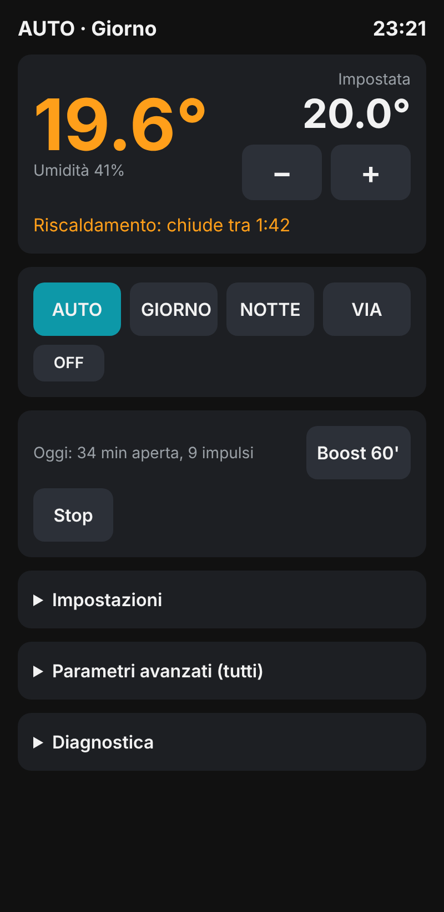 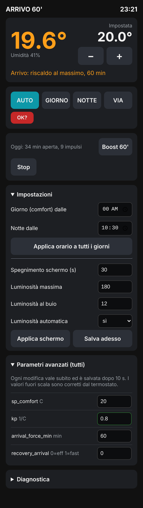

- Live status every 2 s, setpoint −/+, AUTO / GIORNO / NOTTE / VIA→ARRIVO, OFF (two taps),
  Boost 60' / Stop, today's open minutes and pulses.
- **The phone sets the clock**: when the base's time is unknown or more than 30 s off, the page
  sends the phone's time (best time source; the room node's RTC follows it).
- **Impostazioni**: day/night start for all days, screen timeout and brightness, save now.
- **Parametri avanzati**: every control parameter (same names as the console and the AVANZATE
  page). A change applies at once, is clamped to the allowed range and saved after 10 s.
- **Diagnostica**: the STATO page's values.
- Protection: the Wi-Fi password only (no PIN yet). Anyone on that Wi-Fi can change settings.

The page and the touch screen use the same request path into the control task, so the hard
rules (valve pauses, setpoint limits) hold whatever the page sends.

| Endpoint | Purpose |
|---|---|
| `GET /api/status` | JSON: temperatures, setpoint, mode, valve, timers, alarms, clock, counters, node, schedule and screen settings |
| `GET /api/params` | JSON list: `name`, `value`, `unit`, `step`, `kind` (1 = on/off or choice) |
| `POST /api/set` `name=&value=` | Change one parameter |
| `POST /api/cmd` `c=mode&v=0..4` · `c=sp&v=` · `c=adj&v=` · `c=boost&v=min` · `c=stop` · `c=arrive` · `c=time&v=unix` · `c=sched&v=dayMin&v2=nightMin` · `c=screen&v=timeout&v2=max&v3=min&v4=auto` · `c=save` | Commands (form-encoded) |

Try the page without hardware: `python3 tools/web_mock/mock_server.py` → http://localhost:8080
(fake API with a little state). Not yet: graphs, per-day schedule, pairing, OTA, PIN.

## Serial console (115200 baud, implemented in v0.1)

Type `help`. Every change goes through the same validated request path as the touch screen.

| Command | Effect |
|---|---|
| `status` (or `s`) | Everything: time, mode, temperatures, PI terms, valve, counters, alarms, link |
| `params`, `get <name>`, `set <name> <value>` | Read / change any parameter of [04 §7](04-control-algorithm.md) (clamped, saved after 10 s) |
| `mode auto\|comfort\|night\|away\|off` | Also Italian: `giorno`, `notte`, `via`, `spento` |
| `sp <degC>` | Setpoint (5–25 °C, as the +/− buttons) |
| `boost <min>\|off` | Boost 1–240 min. Never shortens the 5 min valve pause. `boost off` also ends ARRIVO's forced hour |
| `arrive` (or `arrivo`) | Same as the ARRIVO button |
| `time YYYY-MM-DD HH:MM[:SS]` | Set the clock (local time, Europe/Rome with DST). Best time source; the node RTC follows it |
| `sched`, `sched default`, `sched <all\|wk\|we\|mon..sun> HH:MM=C HH:MM=N ...` | Show / edit the weekly program (max 4 slots per day) |
| `pair`, `forget-nodes` | 60 s pairing window / forget all nodes |
| `touch on\|off`, `cal xmin xmax ymin ymax swap invx invy` | Raw touch dump, touch calibration |
| `screen <timeout_s> [max] [min] [auto 0/1]` | Screen timeout 10–255 s, max brightness 10–255, dark-room brightness, auto-brightness |
| `reset-learning duty\|offset\|all`, `save`, `reboot`, `factory YES` | Maintenance |
