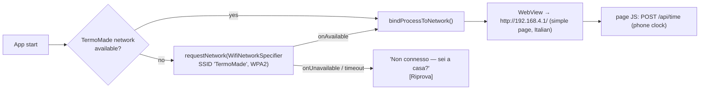

# 12 — Android app (for the parents)

## Goal

One icon on the parents' phone. Tap → see the room temperature, make it warmer/colder, switch
Giorno / Notte / Via. Works **inside the house only**, over the base's Wi-Fi AP, **without
internet**. No accounts, no cloud, no Play Store.

## Why a small native app (and not just a browser bookmark)

| Problem | Browser bookmark | Native shell |
|---|---|---|
| Android sends traffic over **mobile data** when the joined Wi-Fi has no internet, so `192.168.4.1` may be unreachable | Unreliable; parents would have to fiddle with "use without internet" or turn off mobile data | The app **binds its traffic to the TermoMade network** (`ConnectivityManager.bindProcessToNetwork`) |
| Joining the AP | Manual, via Wi-Fi settings | The app requests the network itself (`WifiNetworkSpecifier`, Android 10+). One system confirmation the first time |
| Installable "app" (PWA) | Needs HTTPS, which isn't practical on a local ESP32 | Real icon, full screen |
| Cleartext HTTP | Works | Allowed explicitly for `192.168.4.1` / `termomade.local` (network security config) |

## Design: thin shell + UI served by the base

- **The UI lives on the base** (`/` simple page, see [07](07-user-interface.md#web-ui)). Firmware
  updates update the app's content too, so there's a single UI to maintain.
- The shell provides: connection handling, full-screen WebView, pull-to-refresh, an error screen in
  Italian, and a hidden settings page (long-press the title) for SSID/password and "open advanced
  pages".
- The phone's clock is pushed to the base on every open, which keeps the system time right.
- Later, if wanted: a native Jetpack Compose screen using the same JSON API, with the WebView kept
  for the advanced pages.

## Tech

| Item | Choice |
|---|---|
| Language / UI | Kotlin, single Activity, Android WebView (Compose later if needed) |
| Min SDK | 29 (Android 10, needed for `WifiNetworkSpecifier`). Check the parents' phones (D17) |
| Permissions | `INTERNET`, `ACCESS_NETWORK_STATE`, `CHANGE_NETWORK_STATE`, `ACCESS_WIFI_STATE`. Check in the spike whether the Android versions in use also ask for location to request a specific SSID |
| Cleartext | `network_security_config.xml` allowing HTTP to `192.168.4.1` and `termomade.local` only |
| Build | Gradle project in `android/`. **GitHub Actions** builds a signed APK on each tag and attaches it to a GitHub Release (signing key in repo secrets). No Android Studio needed for releases |
| Install | Sideload the APK once ("install unknown apps" for the file manager/browser). Updates the same way, rarely needed because the UI lives on the base |

## Phasing

- **Phase 2 (MVP):** parents can already use the CYD screen. Andrea tests the web pages from his
  phone's browser.
- **Phase 3:** app v1 (shell + simple page), installed on the parents' phones, tested in the house.
- Spike to do early: connect/bind on the parents' actual Android versions.

## Out of scope (no internet on site)

Remote control from outside the house, push notifications, cloud backup. If the house ever gets
connectivity (even a cheap 4G router), the same API can be exposed through a VPN (e.g.
WireGuard/Tailscale on a small router) without changing the app much.
