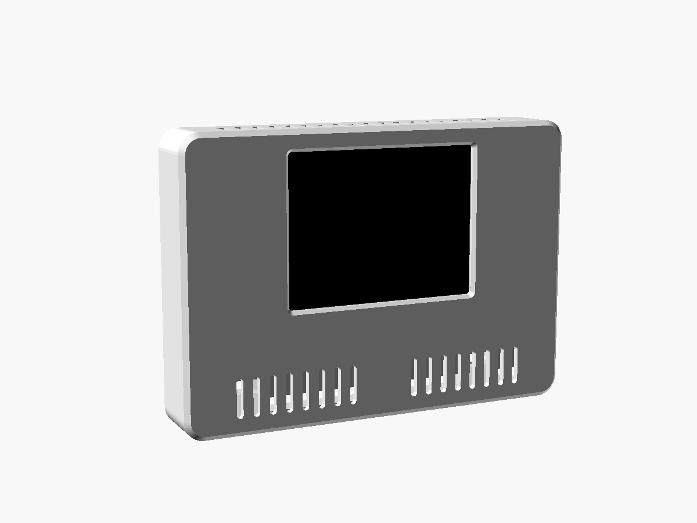
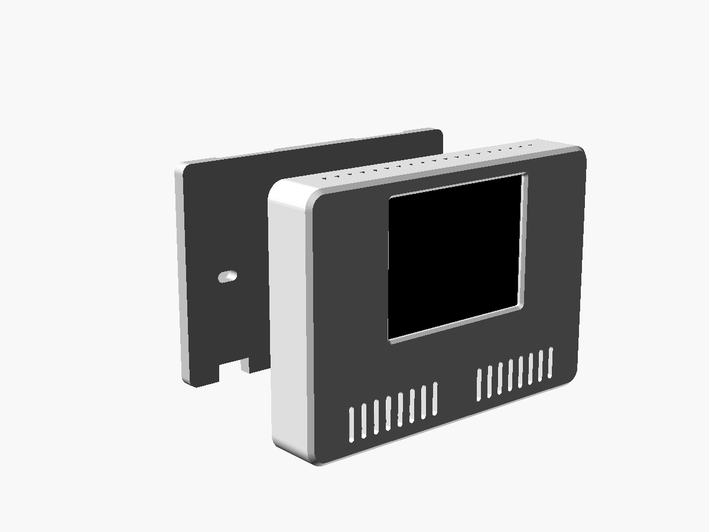
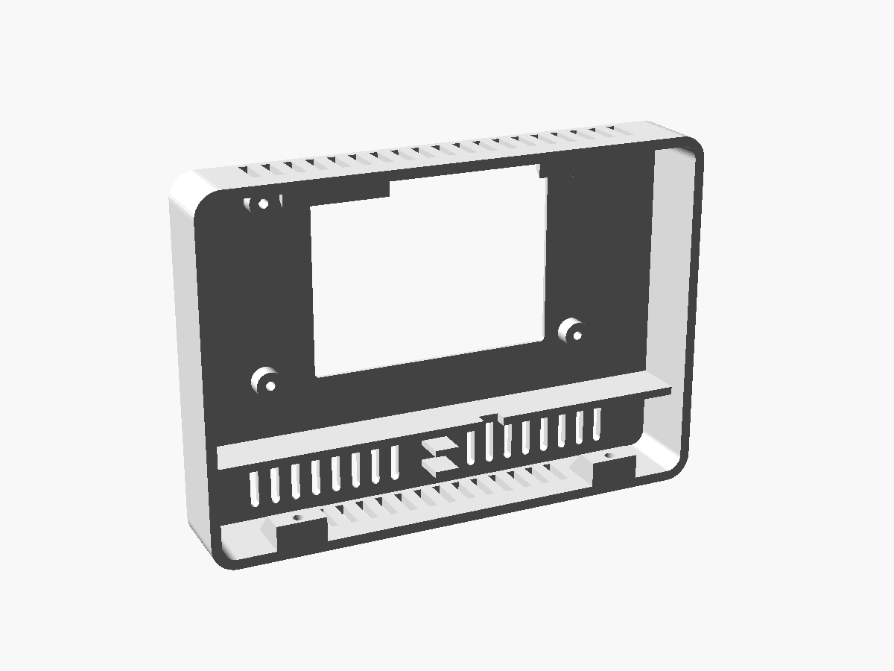
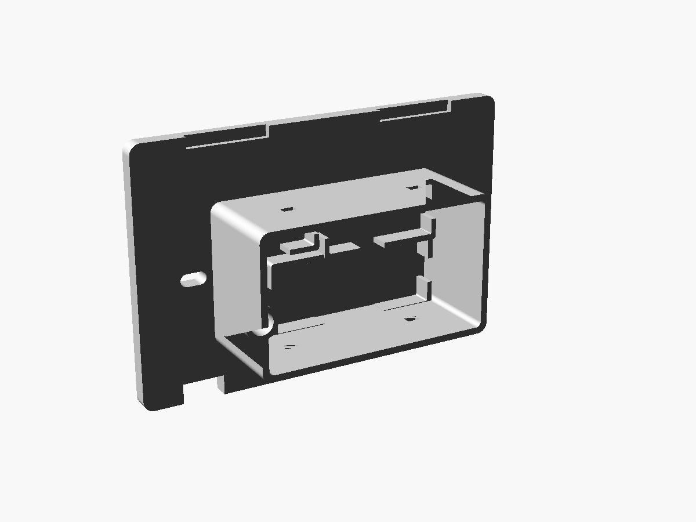
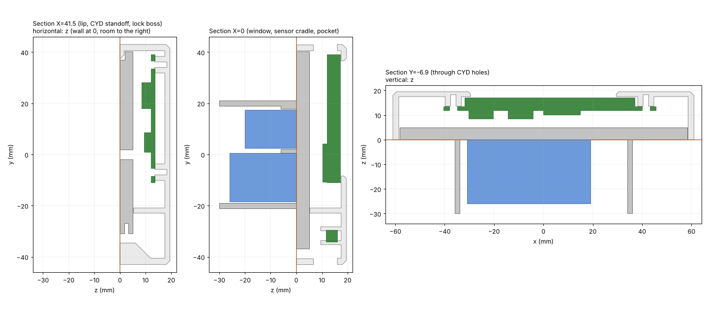

# 13 — Enclosure (parametric OpenSCAD, 2 parts, on the 503 box)

**v1 model:** `hardware/enclosures/termomade_box.scad` (OpenSCAD 2021.01+, all dimensions in the
Customizer). Print-ready STLs in `hardware/enclosures/stl/`. Andrea's rules apply: parametric,
live preview, **no small radii or fillets** (one large 6 mm radius on the vertical edges,
45° chamfers elsewhere).

## Overview

| | |
|---|---|
| Outside | **122 × 86 mm, 19.5 mm** proud of the wall (about the size of a 3-module 503 cover plate) |
| Into the wall | mains pocket 72 × 42 × 30 mm inside the 503 box |
| Parts | **FRONT** (shell with window, CYD, sensor chamber) + **BASE** (plate on the 503 box + mains pocket) |
| Print | both **without supports**: front face-down, base plate face-down with the pocket up |
| Material | PETG or ASA. A flame-retardant (V-0) grade is better for the base. Not PLA |
| Screws | 2 × 503 screws (reuse the old ones), 4 × M2.5×6 self-tapping (CYD), 2 × M3×16 self-tapping (lock) |
| Verified in CAD | No interference: CYD vs both parts, base vs PSU/relay/terminals, front vs base assembled **and along the whole slide-on path** |

## FRONT

- **Display window** 59 × 45 mm (the panel's visible area), 1 mm outer chamfer, centred on
  the box. The CYD sits 2.5 mm off-centre because its display is offset on the PCB.
- **CYD** screwed from behind onto 4 standoffs (Ø6.5) at the PCB holes (78 × 42 mm, Ø3.2). The
  display glass stays **0.3 mm** behind the face and is never pressed.
- **Plug zone** 10 mm below the PCB for the side-entry JST plugs (CN1/P3), 13 mm free on the
  right for P1.
- **Divider** between the CYD compartment and the **sensor chamber** (17.7 mm tall), with a
  notch for the DS18B20 lead.
- **Sensor chamber:** front grille + bottom intake slots, top exhaust slots above the CYD. A
  **TO-92 cradle** (two prongs, 3.8 mm gap) holds the DS18B20 in free air near the grille. A
  6 mm probe clip is selectable (`sensor = "probe6"`).
- **Top lips** (2 × 24 mm) hook behind the base plate. **Two lock bosses** at the bottom take the
  M3 screws coming from below.

## BASE

- Plate 5 mm, **slotted holes at 83.5 mm** for the 503 box screws (±2 mm adjustment).
- **Mains pocket** behind the plate, open towards the wall-box cavity where the mains wires come in.
  It has cradles for the PSU (34 × 15 × 20), the relay module (50 × 19 × 26, standing on its long
  edge) and a terminal block (25 × 10 × 15), plus cable-tie slots. Sizes and positions are
  parameters.
- **LV sleeve** (Ø7 inside, 12 mm long): the only passage from the mains pocket to the CYD
  side, carrying 3 wires: 5 V, GND, relay IN.
- **Rebates** on the wall side of the top edge for the front's lips. **Notches** at the bottom
  for the lock bosses, with Ø3.4 holes that receive the screw tips (they lock the front both
  vertically and against the wall).

## Joint: hook and slide

1. Hold the front **3.5 mm higher** than its final position and push it flat against the wall.
2. **Slide it down 3.5 mm.** The top lips go behind the plate's top edge.
3. Drive **2 × M3×16** up through the bottom. Their tips enter the plate's holes. The front can't
   lift or slide, and only these two screws, from underneath, open it.

## CYD data used (ESP32-2432S028, Sunton drawing + community STEP model)

| Item | Value |
|---|---|
| PCB | 86 × 50 × 1.6 mm, corner R ≈ 3, holes Ø3.2 at 4 mm from the edges (78 × 42 spacing) |
| Display module | 69 × 50 × 3.6 mm, centred on the PCB |
| Visible area | 59 × 45 mm, offset −2.5 mm in X (towards the ESP32 module) |
| Back side | tallest part 4.7 mm (buttons). ESP32 module 25.4 × 18 × 3, antenna at the short edge with the PCB notch |
| Connectors | side-entry JSTs on the long edge (plugs enter from below); USB/P1 on the opposite short edge from the antenna |
| Light sensor | small part on the front, left of the display at about (−39.5, −14) from the PCB centre (`ldr_hole`, off by default) |

Source: `OriginalDocumentation/3-Structure_Diagram/Dimensions.png` and
`3dModels/Havenview_CYD_CAD/*.step` in
[witnessmenow/ESP32-Cheap-Yellow-Display](https://github.com/witnessmenow/ESP32-Cheap-Yellow-Display).
The STEP is the **original 1 × micro-USB board**. Andrea's is the **2-USB (USB-C + micro-USB)**
variant. The outline, holes and display are the same family, but **the USB connector positions
must be checked** before enabling `usb_slot`.

## Print & assemble

| File | Orientation | Notes |
|---|---|---|
| `stl/termomade_fit_test.stl` | as exported | **Print this first (≈ 15 min).** Lay the CYD face-down on it: the 4 holes must sit on the standoffs and the screen must fill the window evenly |
| `stl/termomade_front_print.stl` | face-down | 0.2 mm layers, 3–4 perimeters. Only 1.7 mm ledges and short slot bridges |
| `stl/termomade_base_print.stl` | plate face-down, pocket up | Small horizontal holes (lock pins, tie slots) bridge fine |

Assembly:

1. **Mains (power off at the breaker):** fuse + PSU + relay module + terminal block in the pocket
   cradles. L to the terminal → relay COM and PSU (via fuse). Relay NO → OPEN, NC → CLOSE. N → PSU.
   Tie everything down.
2. Pass the 3 LV wires (5 V, GND, relay IN) through the sleeve. Screw the base onto the 503 box.
3. No heat-set inserts needed: every screw is self-tapping. Screw the CYD into the front
   (4 × M2.5×6). Clip the DS18B20 in the cradle, lead through the divider notch to CN1 (GPIO 27,
   3.3 V, GND, + 4.7 kΩ pull-up).
4. Plug 5 V/GND into **P1**, relay IN into **GPIO 22** (P3/CN1).
5. Hook and slide the front on, then the 2 lock screws from below.

To reflash by USB: remove the 2 lock screws, slide up and lift off. The harness has enough slack
to let the front hang. Normal updates go over Wi-Fi (OTA).

## Parameters you are most likely to touch

| Parameter | Default | When to change |
|---|---|---|
| `view_dx`, `window_extra` | −2.5, 0 | Fit test shows the window off-centre / too tight |
| `cyd_hole_dx/dy` | 78 / 42 | Fit test holes don't sit on the standoffs |
| `cyd_pilot` | 2.2 | M3 screws instead of M2.5 → 2.6 |
| `b503_screw_dx` | 83.5 | Non-standard box |
| `pocket_*`, `psu_*`, `relay_*`, `term_*` | see file | Your actual modules (measure them) |
| `sensor` | `TO92` | `probe6` for a 6 mm stainless probe |
| `usb_slot`, `usb_slot_y` | off, −9.3 | Only after checking where the USB-C sits on your board |
| `ldr_hole`, `ldr_pos` | off | **Turn on for auto-brightness / light logging** (firmware ≥ 0.2), after checking the LDR position on the real board |
| `part` | `assembly` | `exploded`, `section`, `front`, `base`, `*_print`, `fit_test` |

## Mains safety rules (designed in)

1. All 230 V parts **inside the pocket**, and the pocket inside the 503 box. The front holds only
   low voltage. The single passage is the LV sleeve.
2. **≥ 6 mm** between any 230 V terminal/contact and the LV side or the outside. The pocket wall is
   a barrier on top of that, not a substitute.
3. Fuse **T 500 mA** on the PSU input, enclosed PSU module with reinforced isolation.
4. Strain relief with cable ties, terminal block, no loose splices.
5. If anything about the 230 V side is unclear (e.g. no neutral, D13), have an electrician check it.

## Open checks

- [ ] Fit test with the real board (holes, window offset)
- [ ] 503 box opening and depth vs pocket 72 × 42 × 30 (pocket must also clear the screw bosses)
- [ ] Real PSU / relay module / terminal sizes → cradle parameters
- [ ] USB-C / micro-USB position on the 2-USB board (only if a side slot is wanted)
- [ ] Temperature offset of the chamber sensor vs the room node after 24 h (fusion learns it, but
      a big offset means the chamber needs more venting)
